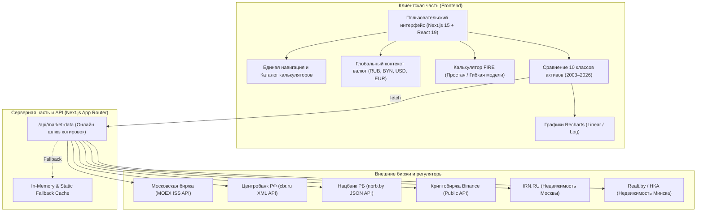
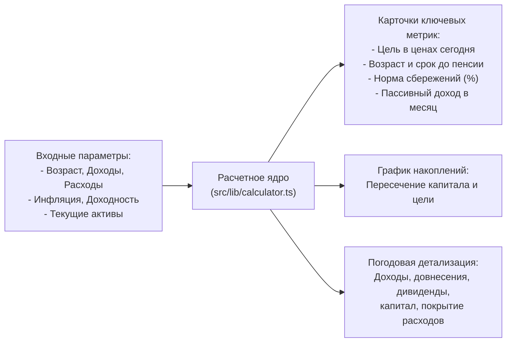
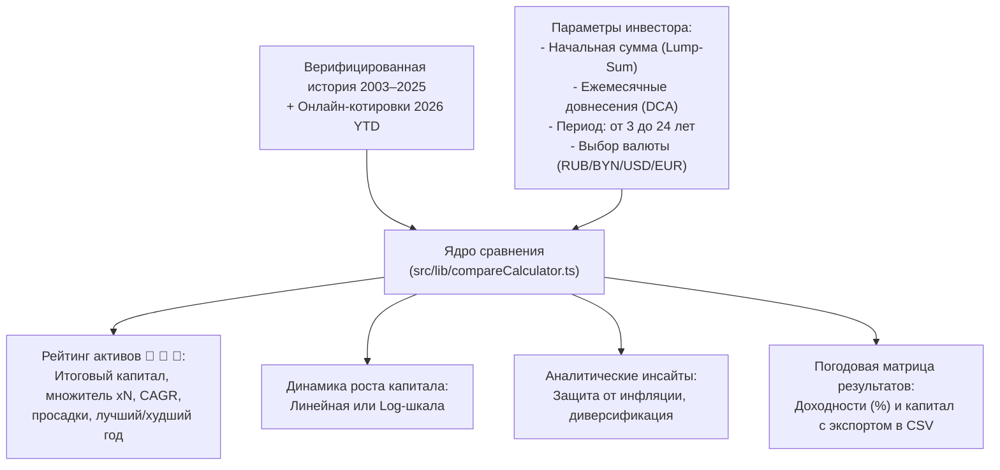
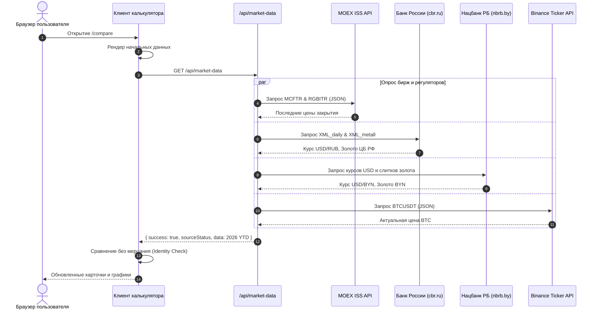

# Архитектура и полное руководство: Финансовый калькулятор & Аналитика активов

> [!NOTE]
> Данный документ представляет собой исчерпывающее техническое и функциональное руководство по проекту. В нем описаны архитектурный стек, математический аппарат калькуляторов, онлайн-конвейер котировок, межвалютные пересчеты и структура компонентов.

---

## 1. Архитектура и стек технологий

Проект представляет собой высокопроизводительную платформу финансового моделирования и анализа инвестиционных инструментов, построенную на современном стеке веб-разработки.



### Основные компоненты технологического стека

* **Next.js 15 (App Router):** Гибридный рендеринг (SSR + CSR), динамические API-роуты, оптимизированная сборка.
* **React 19:** Современные хуки управления состоянием, предотвращение лишних ререндеров (`identity checks`).
* **TypeScript 5.7:** Полная статическая типизация финансовых моделей, параметров входа и структур исторических данных.
* **Tailwind CSS 3.4:** Адаптивный интерфейс с поддержкой широкоформатных мониторов (`max-w-[1840px]`).
* **Recharts 2.15:** Векторная визуализация динамики капитала, логарифмическая и линейная шкалы, кастомные тултипы.
* **Lucide React:** Интуитивная финансовая иконографика.

---

## 2. Глобальная мультивалютность и валютный контекст

Все расчеты на портале поддерживают мгновенный пересчет между четырьмя базовыми валютами:

| Код | Символ | Название | Шаг ввода | Особенности |
| :---: | :---: | :--- | :---: | :--- |
| **RUB** | **₽** | Российский рубль | 5 000 ₽ | Базовый рынок РФ, интеграция с ЦБ РФ и Мосбиржей |
| **BYN** | **Б** | Белорусский рубль | 100 Б | Новый официальный знак `Б`, учет деноминаций и данных НБРБ |
| **USD** | **$** | Доллар США | 100 $ | Мировой бенчмарк, инфляция US CPI |
| **EUR** | **€** | Евро | 100 € | Европейский бенчмарк, кросс-курсы |

> [!TIP]
> При смене валюты в верхнем правом меню состояние автоматически сохраняется в `localStorage` браузера (`fincalc_currency`), а суммы стартового капитала и ежемесячных пополнений автоматически масштабируются по актуальному курсу.

---

## 3. Калькулятор 1: Финансовая независимость (FIRE)

Расположен на главной странице (`/`). Предназначен для расчета срока достижения финансовой независимости, размера необходимого целевого капитала и моделирования жизни с пассивного дохода от инвестиций.



### 3.1. Режимы работы

#### 1. Простая версия (быстрый расчет)
Предназначена для экспресс-оценки горизонта достижения цели:
* **Параметры:** Возраст, Ежемесячный доход, Ежемесячные расходы, Личная инфляция (%), Индексация сбережений (%), Капитал в активах, Стоимость пассивов.
* **Доходность:** Раздельный ввод ожидаемой дивидендной доходности (%) и роста тела капитала (%).
* **Множитель капитала:**
  * `1x (Базовый)`: Дивидендный поток равен 100% расходов.
  * `2x (Удвоенный)`: Повышенная надежность (дивиденды покрывают 200% расходов, излишек реинвестируется).

#### 2. Гибкая версия (детальное планирование)
Включает расширенные параметры риск-менеджмента:
* **Подушка безопасности:** Задание объема резерва в месяцах расходов (например, 6 или 12 месяцев) и ставки доходности по ней (вклады/накопительные счета).
* **Краткосрочные обязательства:** Вычет долгов и кредитов из стартового капитала.
* **Налогообложение:** Учет налога на дивиденды и купоны (НДФЛ 13–15%).
* **Фазы жизни:** Автоматическое переключение формул с фазы активного накопления на фазу пенсионного потребления при пересечении целевой линии.

### 3.2. Математическая модель калькулятора FIRE

1. **Норма сбережений (Savings Rate):**
   $$SR = \frac{\text{Доход} - \text{Расходы}}{\text{Доход}} \times 100\%$$

2. **Целевой капитал в ценах сегодня:**
   $$C_{\text{target, 0}} = \frac{\text{Расходы}_{\text{год}}}{r_{\text{div}} \times (1 - \text{tax}) \times k_{\text{cons}}} + \text{Подушка}$$
   где $r_{\text{div}}$ — дивидендная доходность, $\text{tax}$ — ставка налога, $k_{\text{cons}}$ — доля потребления дивидендов.

3. **Ежегодная индексация расходов и довнесений:**
   $$\text{Расходы}_{t} = \text{Расходы}_{t-1} \times (1 + i_{\text{inf}})$$
   $$\text{Сбережения}_{t} = \text{Сбережения}_{t-1} \times (1 + i_{\text{sav}})$$

4. **Динамика капитала в фазе накопления:**
   $$C_{t} = C_{t-1} \times (1 + g_{\text{body}}) + D_{t} + S_{t}$$
   где $g_{\text{body}}$ — рост тела активов, $D_{t}$ — реинвестированные дивиденды, $S_{t}$ — новые довнесения за год.

---

## 4. Калькулятор 2: Сравнение доходности классов активов

Расположен по адресу (`/compare`). Показывает, как вели бы себя реальные инвестиции в различные классы инструментов за выбранный период (с 2003 по текущий 2026 год).



### 4.1. Поддерживаемые классы активов (10 инструментов)

1. 🇷🇺 **Акции РФ (MCFTR):** Индекс Мосбиржи полной доходности «брутто» (с учетом реинвестирования дивидендов).
2. 🇺🇸 **Акции США (S&P 500 TR):** Индекс 500 крупнейших корпораций США с реинвестированием дивидендов.
3. 🌐 **Физическое золото (XAU):** Учетные цены на аффинированное золото в слитках по данным ЦБ РФ и Нацбанка Беларуси.
4. 🇷🇺 **Недвижимость Москвы:** Индекс цен вторичного жилья столичного региона аналитического центра IRN.RU.
5. 🇧🇾 **Недвижимость Минска:** Индекс цен вторичного жилья Минска по данным портала Realt.by и Национального кадастрового агентства (НКА).
6. 🇷🇺 **Банковские вклады РФ:** Средневзвешенные максимальные ставки депозитов физлиц по данным Банка России с капитализацией процентов.
7. 🇧🇾 **Вклады в BYN (НБРБ):** Средние процентные ставки по безотзывным депозитам в белорусских рублях Нацбанка Беларуси.
8. 🇷🇺 **Гособлигации РФ (ОФЗ RGBITR):** Индекс государственных облигаций Московской биржи с учетом купонных выплат.
9. 🇧🇾 **Гособлигации РБ:** Государственные ценные бумаги Министерства финансов Республики Беларусь.
10. 🪙 **Криптовалюта (Bitcoin / BTC):** Котировки первой криптовалюты с 2011 года по данным бирж.
11. 🌟 **Сбалансированный портфель (1/N):** Портфель с равными долями всех выбранных активов и ежегодной ребалансировкой.

### 4.2. Межвалютный пересчет и кросс-курсы

Для каждого года доходность любого инструмента пересчитывается в целевую валюту пользователя:

* **В российских рублях (RUB):**
  $$R_{\text{SP500, RUB}} = (1 + R_{\text{SP500, USD}}) \times (1 + \Delta_{\text{USD/RUB}}) - 1$$
* **В белорусских рублях (BYN):**
  $$R_{\text{Asset, BYN}} = (1 + R_{\text{Asset, USD}}) \times (1 + \Delta_{\text{USD/BYN}}) - 1$$
* **Минская недвижимость в BYN:**
  $$R_{\text{Minsk, BYN}} = (1 + R_{\text{Minsk, USD}}) \times (1 + \Delta_{\text{USD/BYN}}) - 1$$
* **Реальная доходность (за вычетом инфляции):**
  $$R_{\text{real}} = \frac{1 + R_{\text{nom}}}{1 + I_{\text{cpi}}} - 1$$

---

## 5. Онлайн-конвейер котировок в реальном времени (`/api/market-data`)

Серверный маршрут `src/app/api/market-data/route.ts` опрашивает официальные API бирж и регуляторов в фоновом режиме:



### Спецификация внешних эндпоинтов

1. **Московская биржа (MOEX ISS API):**
   * MCFTR: `https://iss.moex.com/iss/history/engines/stock/markets/index/securities/MCFTR.json?from=2026-11-01&till=2026-12-31&iss.meta=off&history.columns=TRADEDATE,CLOSE`
   * RGBITR: `https://iss.moex.com/iss/history/engines/stock/markets/index/securities/RGBITR.json?from=2026-11-01&till=2026-12-31&iss.meta=off&history.columns=TRADEDATE,CLOSE`
2. **Центральный банк РФ (ЦБ РФ):**
   * Курс валют: `https://www.cbr.ru/scripts/XML_daily.asp?date_req=ДД/ММ/ГГГГ`
   * Учетные цены драгметаллов: `https://www.cbr.ru/scripts/xml_metall.asp?date_req1=...&date_req2=...` (`Code="1"` — золото)
3. **Национальный банк Республики Беларусь (НБРБ):**
   * Курс USD/BYN: `https://api.nbrb.by/exrates/rates/USD?parammode=2`
   * Цены на мерные слитки: `https://www.nbrb.by/api/bankingots/prices?startDate=...&endDate=...` (`MetalId: 0` — золото в BYN/грамм)
4. **Криптовалютные биржи (Binance Public API):**
   * Биткоин: `https://api.binance.com/api/v3/ticker/price?symbol=BTCUSDT`
5. **Недвижимость:**
   * Вторичный рынок Москвы: аналитический центр IRN.RU
   * Вторичный рынок Минска: портал Realt.by и Национальное кадастровое агентство (НКА).

> [!IMPORTANT]
> **Отказоустойчивость:** Каждый сетевой запрос обернут в контроллер таймаута (3.5 сек). Если внешний сервер недоступен, калькулятор мгновенно переключается на верифицированные кешированные ориентиры без задержки и падения страницы.

---

## 6. Структура файлов проекта

```
f:\Calculator\
├── src/
│   ├── app/
│   │   ├── api/
│   │   │   └── market-data/
│   │   │       └── route.ts         # Онлайн шлюз котировок MOEX, ЦБ РФ, НБРБ, Binance
│   │   ├── compare/
│   │   │   └── page.tsx             # Страница калькулятора сравнения активов
│   │   ├── layout.tsx               # Корневой макет с подключением CurrencyProvider
│   │   ├── page.tsx                 # Главная страница (Калькулятор FIRE)
│   │   └── globals.css              # Стили Tailwind CSS и анимации
│   ├── components/
│   │   ├── compare/
│   │   │   ├── AssetComparisonCalculator.tsx # Контейнер сравнения активов
│   │   │   ├── CompareAnnualTable.tsx        # Погодовая матрица результатов и экспорт CSV
│   │   │   ├── CompareChart.tsx              # Интерактивный график роста капитала
│   │   │   ├── CompareInputPanel.tsx         # Панель параметров, фильтры стран и онлайн-статус
│   │   │   ├── CompareInsights.tsx           # Блок аналитических выводов
│   │   │   └── CompareLeaderboard.tsx        # Карточки рейтинга доходности 🥇 🥈 🥉
│   │   ├── icons/                   # Векторные иконки валют (BYN, RUB, USD, EUR)
│   │   ├── CapitalChart.tsx         # График FIRE
│   │   ├── CurrencyDropdown.tsx     # Меню выбора валюты
│   │   ├── FireCalculator.tsx       # Главный контейнер калькулятора FIRE
│   │   ├── InputForm.tsx            # Форма ввода параметров FIRE
│   │   ├── MetricCards.tsx          # Плитки ключевых показателей FIRE
│   │   ├── Navigation.tsx           # Шапка сайта и каталог инструментов
│   │   ├── SimulationTable.tsx      # Таблица расчетов FIRE по годам
│   │   └── Tabs.tsx                 # Переключатель режимов Простой / Гибкий
│   ├── context/
│   │   └── CurrencyContext.tsx      # Глобальный контекст валют с localStorage
│   ├── data/
│   │   └── historicalReturns.ts     # Верифицированная историческая база доходностей (2003–2026)
│   ├── lib/
│   │   ├── __tests__/               # Модульные тесты калькуляторов
│   │   ├── calculator.ts            # Математическое ядро FIRE
│   │   ├── compareCalculator.ts     # Математическое ядро сравнения активов и кросс-курсов
│   │   ├── formatters.ts            # Форматирование валют, чисел и компактных подписей
│   │   └── validation.ts            # Валидация диапазонов входных данных
│   └── types/
│       ├── compare.ts               # Типы для калькулятора сравнения активов
│       └── fire.ts                  # Типы для калькулятора FIRE
├── package.json
├── tailwind.config.ts
└── tsconfig.json
```

---

## 7. Команды сборки, тестирования и запуска

* **Запуск сервера разработки:**
  ```powershell
  npm run dev
  ```
  Сервер доступен по адресу: `http://localhost:3000`.

* **Запуск автоматических тестов:**
  ```powershell
  npm test
  ```
  Запускает полный комплект тестов:
  * Проверка всех сценариев калькулятора FIRE (простой, гибкий, досрочный выход, множитель 2x).
  * Проверка калькулятора сравнения активов (Lump-sum, DCA, сбалансированный портфель, конвертация валют, симуляция 2003–2026).

* **Сборка production-версии:**
  ```powershell
  npm run build
  ```

* **Запуск скомпилированной production-версии:**
  ```powershell
  npm start
  ```
