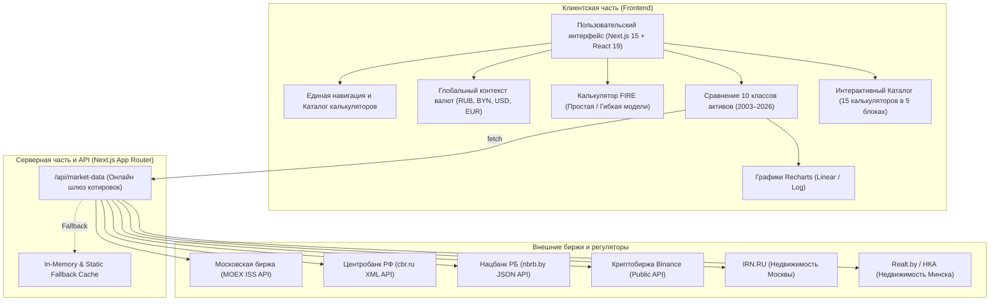
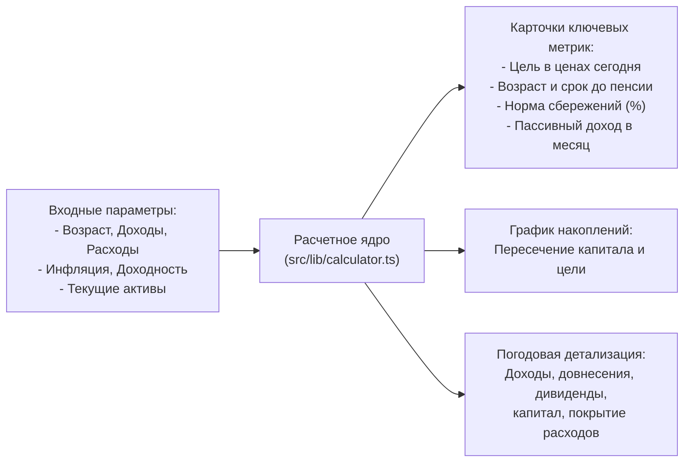
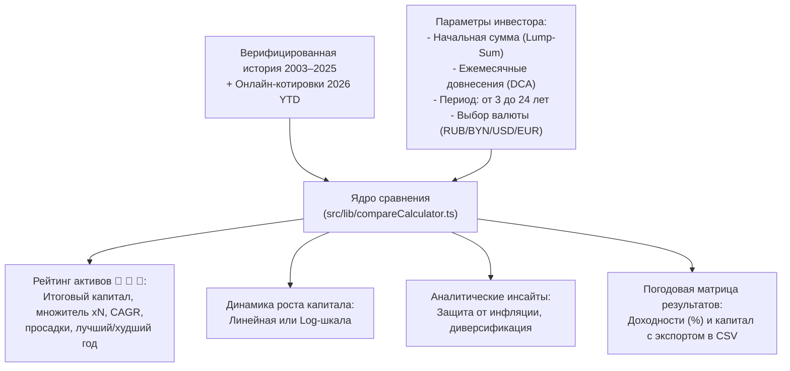
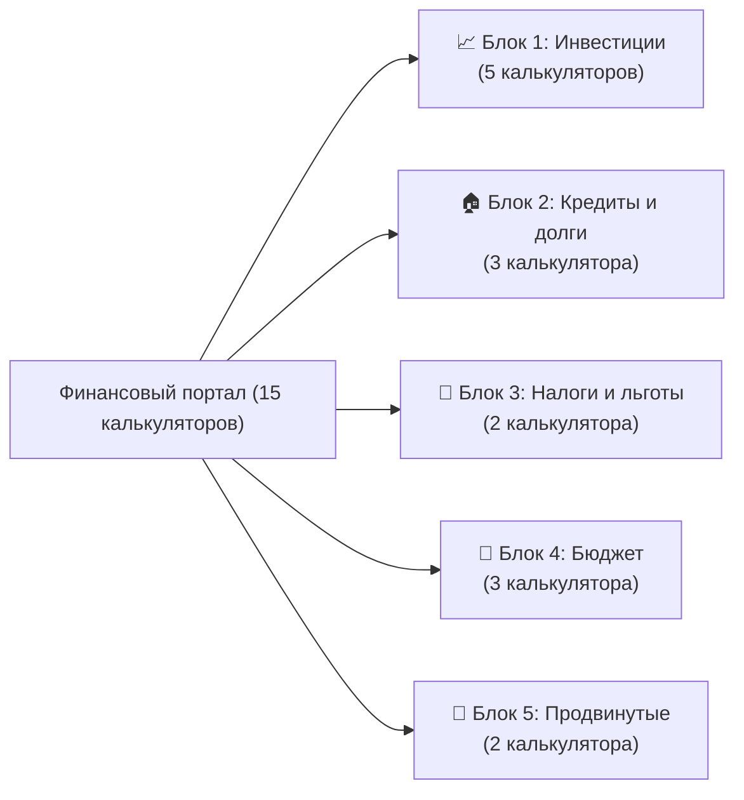

# Архитектура и полное руководство: Финансовый калькулятор & Аналитика активов

> [!NOTE]
> Данный документ представляет собой исчерпывающее техническое и функциональное руководство по проекту. В нем описаны архитектурный стек, математический аппарат калькуляторов, онлайн-конвейер котировок, межвалютные пересчеты и структура компонентов.

---

## 1. Архитектура и стек технологий

Проект представляет собой высокопроизводительную платформу финансового моделирования и анализа инвестиционных инструментов, построенную на современном стеке веб-разработки.



### Основные компоненты технологического стека

* **Next.js 15 (App Router):** Гибридный рендеринг (SSR + CSR), динамические API-роуты, модульные директории страниц под каждый калькулятор.
* **React 19:** Современные хуки управления состоянием, предотвращение лишних ререндеров (`identity checks`).
* **TypeScript 5.7:** Полная статическая типизация финансовых моделей, параметров входа и структур каталога.
* **Tailwind CSS 3.4:** Адаптивный интерфейс с поддержкой широкоформатных мониторов (`max-w-[1840px]`).
* **Recharts 2.15:** Векторная визуализация динамики капитала, логарифмическая и линейная шкалы, кастомные тултипы.
* **Lucide React:** Интуитивная финансовая иконографика.

---

## 2. Глобальная мультивалютность и валютный контекст

Все расчеты на портале поддерживают мгновенный пересчет между четырьмя базовыми валютами:

| Код | Символ | Название | Шаг ввода | Особенности |
| :---: | :---: | :--- | :---: | :--- |
| **RUB** | **₽** | Российский рубль | 5 000 ₽ | Базовый рынок РФ, интеграция с ЦБ РФ и Мосбиржей |
| **BYN** | **Б** | Белорусский рубль | 100 Б | Новый официальный знак `Б`, учет деноминаций и данных НБРБ |
| **USD** | **$** | Доллар США | 100 $ | Мировой бенчмарк, инфляция US CPI |
| **EUR** | **€** | Евро | 100 € | Европейский бенчмарк, кросс-курсы |

> [!TIP]
> При смене валюты в верхнем правом меню состояние автоматически сохраняется в `localStorage` браузера (`fincalc_currency`), а суммы стартового капитала и ежемесячных пополнений автоматически масштабируются по актуальному курсу.

---

## 3. Калькулятор 1: Финансовая независимость (FIRE)

Расположен на главной странице (`/`). Предназначен для расчета срока достижения финансовой независимости, размера необходимого целевого капитала и моделирования жизни с пассивного дохода от инвестиций.



### 3.1. Режимы работы

#### 1. Простая версия (быстрый расчет)
* **Параметры:** Возраст, Ежемесячный доход, Ежемесячные расходы, Личная инфляция (%), Индексация сбережений (%), Капитал в активах, Стоимость пассивов.
* **Доходность:** Раздельный ввод ожидаемой дивидендной доходности (%) и роста тела капитала (%).
* **Множитель капитала:**
  * `1x (Базовый)`: Дивидендный поток равен 100% расходов.
  * `2x (Удвоенный)`: Повышенная надежность (дивиденды покрывают 200% расходов, излишек реинвестируется).

#### 2. Гибкая версия (детальное планирование)
* **Подушка безопасности:** Задание объема резерва в месяцах расходов (например, 6 или 12 месяцев) и ставки доходности по ней (вклады/накопительные счета).
* **Краткосрочные обязательства:** Вычет долгов и кредитов из стартового капитала.
* **Налогообложение:** Учет налога на дивиденды и купоны (НДФЛ 13–15%).
* **Фазы жизни:** Автоматическое переключение формул с фазы активного накопления на фазу пенсионного потребления при пересечении целевой линии.

---

## 4. Калькулятор 2: Сравнение доходности классов активов

Расположен по адресу (`/compare`). Показывает, как вели бы себя реальные инвестиции в различные классы инструментов за выбранный период (с 2003 по текущий 2026 год).



### 4.1. Поддерживаемые классы активов (10 инструментов)

1. 🇷🇺 **Акции РФ (MCFTR):** Индекс Мосбиржи полной доходности «брутто» (с реинвестированием дивидендов).
2. 🇺🇸 **Акции США (S&P 500 TR):** Индекс 500 крупнейших корпораций США с реинвестированием дивидендов.
3. 🌐 **Физическое золото (XAU):** Учетные цены на золото по данным ЦБ РФ и Нацбанка Беларуси.
4. 🇷🇺 **Недвижимость Москвы:** Индекс цен вторичного жилья IRN.RU.
5. 🇧🇾 **Недвижимость Минска:** Индекс цен вторичного жилья Минска Realt.by и НКА.
6. 🇷🇺 **Банковские вклады РФ:** Средневзвешенные максимальные ставки депозитов ЦБ РФ с капитализацией.
7. 🇧🇾 **Вклады в BYN (НБРБ):** Ставки по безотзывным депозитам в белорусских рублях Нацбанка Беларуси.
8. 🇷🇺 **Гособлигации РФ (ОФЗ RGBITR):** Индекс государственных облигаций Мосбиржи с учетом купонов.
9. 🇧🇾 **Гособлигации РБ:** Государственные ценные бумаги Министерства финансов Республики Беларусь.
10. 🪙 **Криптовалюта (Bitcoin / BTC):** Котировки первой криптовалюты с 2011 года.
11. 🌟 **Сбалансированный портфель (1/N):** Портфель с равными долями всех выбранных активов и ежегодной ребалансировкой.

---

## 5. Онлайн-конвейер котировок в реальном времени (`/api/market-data`)

Серверный маршрут `src/app/api/market-data/route.ts` опрашивает официальные API бирж и регуляторов в фоновом режиме:

* **Московская биржа (MOEX ISS API):** MCFTR и RGBITR.
* **Центральный банк РФ (ЦБ РФ):** курс USD/RUB и золото XAU.
* **Национальный банк Республики Беларусь (НБРБ):** курс USD/BYN и слитки золота в BYN.
* **Криптовалютные биржи (Binance Public API):** BTC/USDT.
* **Недвижимость:** аналитический центр IRN.RU и портал Realt.by / НКА.

---

## 6. Полный реестр всех 15 калькуляторов в 5 блоках

Каталог структурирован по пяти функциональным блокам:



### 📈 Блок 1: Инвестиции и пассивный доход
1. **Калькулятор FIRE (`/`)** — *Статус: Готов*. Расчет срока и необходимого капитала для жизни на пассивный доход.
2. **Калькулятор сложного процента (`/compound`)** — *Статус: В разработке*. Моделирование эффекта времени и регулярных довнесений (DCA).
3. **Калькулятор дивидендов (`/dividends`)** — *Статус: В разработке*. Прогноз дивидендного денежного потока и пассивной зарплаты.
4. **Калькулятор доходности облигаций YTM (`/bonds-ytm`)** — *Статус: В разработке*. Расчет эффективной доходности к погашению и оферте.
5. **Калькулятор цели (`/goal`)** — *Статус: В разработке*. Обратный расчет ежемесячного платежа под конкретную сумму и срок.

### 🏠 Блок 2: Кредиты и долги
6. **Ипотечный калькулятор с досрочным погашением (`/mortgage`)** — *Статус: В разработке*. График платежей и экономия от сокращения срока или платежа.
7. **Калькулятор досрочного погашения любого кредита (`/loan-early-repayment`)** — *Статус: В разработке*. Универсальный расчет экономии на процентах.
8. **Калькулятор кредитной карты (`/credit-card`)** — *Статус: В разработке*. Расчет контрольных дат грейс-периода и минимального платежа.

### 🧾 Блок 3: Налоги и государственные льготы
9. **Налоговый калькулятор для вкладов (`/tax-deposits`)** — *Статус: В разработке*. Учет подоходного налога 13% с учетом сроков и необлагаемых лимитов в РБ и РФ.
10. **Калькулятор налогового вычета (`/tax-deduction`)** — *Статус: В разработке*. Возврат налога по пенсионным программам, покупке жилья и лечению.

### 🎯 Блок 4: Планирование и бюджет
11. **Калькулятор подушки безопасности (`/emergency-fund`)** — *Статус: В разработке*. Расчет резервного фонда на 3, 6 или 12 месяцев расходов.
12. **Бюджетный планировщик 50/30/20 (`/budget-50-30-20`)** — *Статус: В разработке*. Распределение доходов на нужды (50%), желания (30%) и инвестиции (20%).
13. **Калькулятор инфляции (`/inflation`)** — *Статус: В разработке*. Оценка обесценения накоплений и реальной покупательной способности.

### 💎 Блок 5: Специализированные и продвинутые инструменты
14. **Калькулятор Монте-Карло (`/monte-carlo`)** — *Статус: В разработке*. Вероятностный стресс-тест портфеля с прогоном 10 000 случайных сценариев.
15. **Сравнение классов активов (`/compare`)** — *Статус: Готов*. Анализ доходности 10 классов активов за 24 года с онлайн-котировками.

---

## 7. Модульная структура папок проекта

Каждый калькулятор имеет собственную выделенную страницу в `src/app/<route>/` и изолированную директорию компонентов в `src/components/<calculator>/`:

```
f:\Calculator\
├── src/
│   ├── app/
│   │   ├── api/market-data/route.ts      # Онлайн шлюз котировок (MOEX, ЦБ РФ, НБРБ, Binance)
│   │   ├── catalog/page.tsx              # Интерактивный каталог всех 15 калькуляторов
│   │   ├── compare/page.tsx              # Калькулятор сравнения активов
│   │   ├── compound/page.tsx             # Калькулятор сложного процента
│   │   ├── dividends/page.tsx            # Калькулятор дивидендов
│   │   ├── bonds-ytm/page.tsx            # Калькулятор доходности облигаций (YTM)
│   │   ├── goal/page.tsx                 # Калькулятор цели (обратный расчет)
│   │   ├── mortgage/page.tsx             # Ипотечный калькулятор с досрочным погашением
│   │   ├── loan-early-repayment/page.tsx # Досрочное погашение кредита
│   │   ├── credit-card/page.tsx          # Калькулятор кредитной карты (льготный период)
│   │   ├── tax-deposits/page.tsx         # Налоговый калькулятор для вкладов
│   │   ├── tax-deduction/page.tsx        # Калькулятор налогового вычета
│   │   ├── emergency-fund/page.tsx       # Калькулятор подушки безопасности
│   │   ├── budget-50-30-20/page.tsx      # Бюджетный планировщик 50/30/20
│   │   ├── inflation/page.tsx            # Калькулятор инфляции
│   │   ├── monte-carlo/page.tsx          # Калькулятор Монте-Карло
│   │   ├── page.tsx                      # Главная страница (Калькулятор FIRE)
│   │   ├── layout.tsx                    # Корневой макет приложения
│   │   └── globals.css                   # Стили Tailwind CSS
│   ├── components/
│   │   ├── compare/                      # Компоненты сравнения активов
│   │   ├── common/                       # Общие компоненты (UnderDevelopmentPage и др.)
│   │   ├── compound/                     # Компоненты сложного процента
│   │   ├── dividends/                    # Компоненты дивидендного калькулятора
│   │   ├── bonds-ytm/                    # Компоненты калькулятора облигаций
│   │   ├── goal/                         # Компоненты калькулятора цели
│   │   ├── mortgage/                     # Компоненты ипотечного калькулятора
│   │   ├── loan-early-repayment/         # Компоненты досрочного погашения
│   │   ├── credit-card/                  # Компоненты калькулятора кредитных карт
│   │   ├── tax-deposits/                 # Компоненты налогообложения вкладов
│   │   ├── tax-deduction/                # Компоненты налоговых вычетов
│   │   ├── emergency-fund/               # Компоненты подушки безопасности
│   │   ├── budget-50-30-20/              # Компоненты бюджетного планировщика
│   │   ├── inflation/                    # Компоненты калькулятора инфляции
│   │   ├── monte-carlo/                  # Компоненты Монте-Карло симуляций
│   │   ├── icons/                        # Векторные иконки валют (BYN, RUB, USD, EUR)
│   │   └── Navigation.tsx                # Единая навигация и выпадающий каталог
│   ├── data/
│   │   ├── calculatorsCatalog.ts         # Реестр метаданных 15 калькуляторов и 5 блоков
│   │   └── historicalReturns.ts          # Историческая база доходностей (2003–2026)
│   ├── lib/
│   │   ├── __tests__/                    # Автоматические тесты
│   │   ├── calculator.ts                 # Математическое ядро FIRE
│   │   ├── compareCalculator.ts          # Математическое ядро сравнения активов
│   │   └── formatters.ts                 # Форматирование валют и чисел
│   └── types/
│       ├── calculators.ts                # Типы каталога и блоков калькуляторов
│       ├── compare.ts                    # Типы сравнения активов
│       └── fire.ts                       # Типы калькулятора FIRE
```

---

## 8. Команды сборки, тестирования и запуска

* **Запуск сервера разработки:**
  ```powershell
  npm run dev
  ```
  Сервер доступен по адресу: `http://localhost:3000`.

* **Запуск автоматических тестов:**
  ```powershell
  npm test
  ```

* **Сборка production-версии:**
  ```powershell
  npm run build
  ```

* **Запуск скомпилированной production-версии:**
  ```powershell
  npm start
  ```
